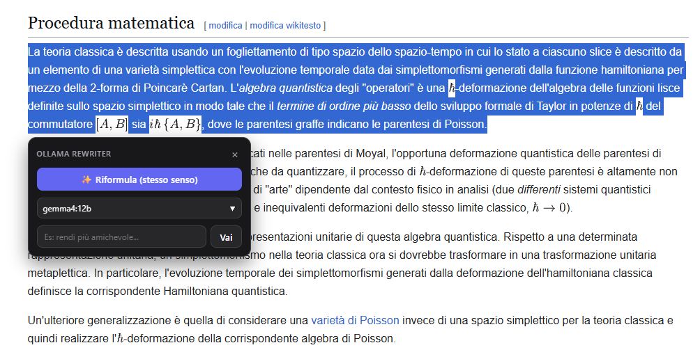
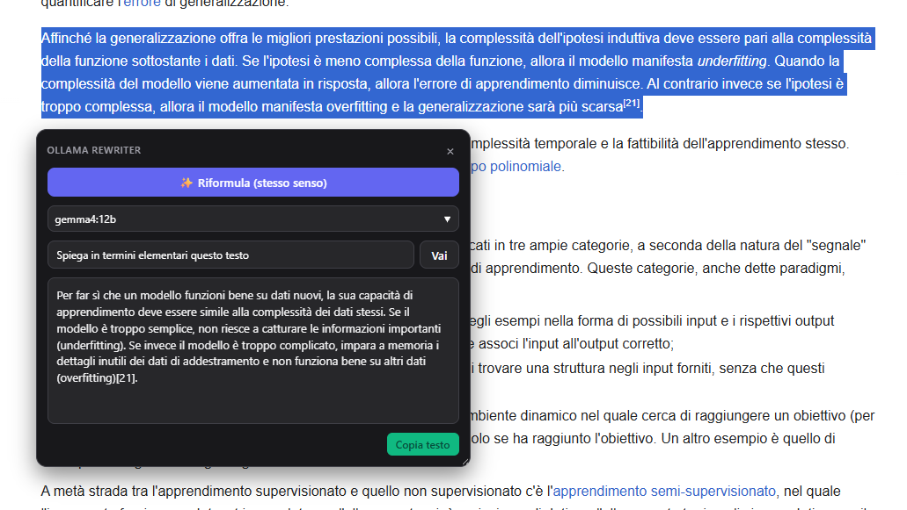
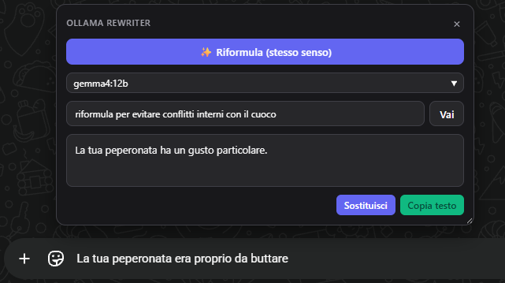

<h1 align="center">Ollama Text Rewriter</h1>

A Chromium browser extension that rewrites or edits selected text using a local <a href="https://ollama.com">Ollama</a> model. 
No cloud, no account: your text never leaves your computer.

<a href="README.md">Italiano</a> · English

   Select text, then pick a model or a prompt

   Result with a custom prompt

   In-place replacement in text fields

## Features

- Select text on any page and a ✨ icon appears next to the selection.
- **Rephrase** in one click (same meaning, different words) or use a **custom prompt** (e.g. "make it friendlier").
- **Replace** the text in place in `<textarea>`, `<input>` and `contenteditable` fields, or **Copy** it.
- Model picker dropdown (read from `ollama list`, embedding models excluded), remembered across sessions.
- Draggable popup, cancellable request, close with **×** or **Esc**.
- UI isolated in a Shadow DOM: it does not interfere with the page's styles.

## Installation

Requires [Ollama](https://ollama.com) running and at least one model pulled (`ollama pull <model>`).

1. **Allow the extension in Ollama.** Set the `OLLAMA_ORIGINS` environment variable and restart Ollama, otherwise it replies 403:
   - safer: `OLLAMA_ORIGINS=chrome-extension://*`
   - more permissive: `OLLAMA_ORIGINS=*` (allows requests from any website: only use it if you understand the risk)
2. Download or clone this repository.
3. Open `chrome://extensions` (or `opera://`, `edge://`, `brave://extensions`), enable **Developer mode**, click **Load unpacked** and select the project folder.

After changing the code, reload the extension and refresh any open pages.

## How it works

| File | Role |
|---|---|
| `manifest.json` | Manifest V3: `storage` permission, access to `localhost:11434` only |
| `content.js` | Detects the selection, renders the popup (Shadow DOM), replaces the text |
| `background.js` | Service worker: the only part that talks to the Ollama API (`/api/generate`, `/api/tags`) |

The default model (`DEFAULT_MODEL` in `background.js`, `gemma4:12b`) is used only until you pick one.

## Privacy

The only network requests go to `http://localhost:11434`. There is no telemetry. The only stored data (`chrome.storage.local`) is the name of the selected model.
The content script runs on all pages (`<all_urls>`) because it must read the selection anywhere.

## License

[MIT](LICENSE)
