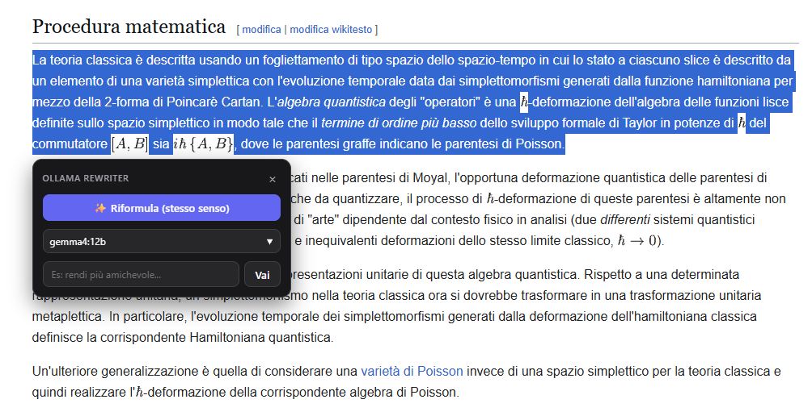
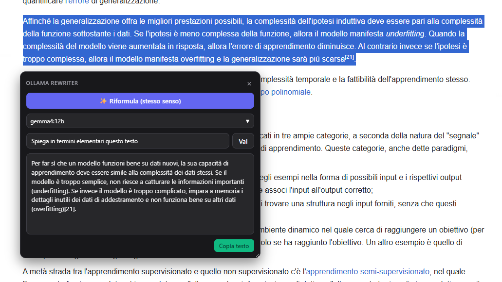
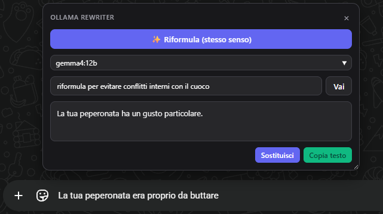

<h1 align="center">Ollama Text Rewriter</h1>

Estensione per browser Chromium che riformula o modifica il testo selezionato usando un modello <a href="https://ollama.com">Ollama</a> in locale. 
Nessun cloud, nessun account: il testo non lascia mai il tuo computer.

Italiano · <a href="README.en.md">English</a>

   Seleziona il testo e scegli modello o prompt

   Risultato con prompt personalizzato

   Sostituzione diretta nei campi di testo

## Funzionalità

- Selezioni del testo in qualsiasi pagina e compare l'icona ✨ accanto alla selezione.
- **Riformula** con un clic (stesso senso, parole diverse) oppure con un **prompt personalizzato** (es. «rendi più amichevole»).
- **Sostituisci** il testo direttamente in `<textarea>`, `<input>` e `contenteditable`, oppure **Copia**.
- Scelta del modello da menu a tendina (letto da `ollama list`, embedding esclusi), ricordata tra le sessioni.
- Popup trascinabile, richiesta annullabile, chiusura con **×** o **Esc**.
- UI isolata in Shadow DOM: non interferisce con gli stili della pagina.

## Installazione

Richiede [Ollama](https://ollama.com) in esecuzione e almeno un modello scaricato (`ollama pull <modello>`).

1. **Consenti l'estensione in Ollama.** Imposta la variabile d'ambiente `OLLAMA_ORIGINS` e riavvia Ollama, altrimenti risponde 403:
   - più sicuro: `OLLAMA_ORIGINS=chrome-extension://*`
   - più permissivo: `OLLAMA_ORIGINS=*` (consente richieste da qualsiasi sito: usalo solo se sai cosa fai)
2. Scarica o clona il repository.
3. Apri `chrome://extensions` (o `opera://`, `edge://`, `brave://extensions`), attiva **Modalità sviluppatore** e premi **Carica estensione non pacchettizzata**, selezionando la cartella del progetto.

Dopo ogni modifica al codice, ricarica l'estensione e aggiorna le pagine già aperte.

## Come funziona

| File | Ruolo |
|---|---|
| `manifest.json` | Manifest V3: permesso `storage`, accesso solo a `localhost:11434` |
| `content.js` | Rileva la selezione, disegna il popup (Shadow DOM), sostituisce il testo |
| `background.js` | Service worker: unico punto che parla con l'API di Ollama (`/api/generate`, `/api/tags`) |

Il modello predefinito (`DEFAULT_MODEL` in `background.js`, `gemma4:12b`) è usato solo finché non ne scegli uno.

## Privacy

Le uniche richieste di rete vanno a `http://localhost:11434`. Non c'è telemetria. L'unico dato salvato (`chrome.storage.local`) è il nome del modello scelto.
Il content script gira su tutte le pagine (`<all_urls>`) perché deve poter leggere la selezione ovunque.

## Licenza

[MIT](LICENSE)
